# Main feature flow diagrams

> **Since 2026-10-31, the parts of this document about Android's look, layout and interaction are superseded by [Android interface styles and design system](../../android/android-design.md)**: the user asked for the visuals and interaction to be redone as a whole, as three interface styles: Glass (default), Morning Paper and Board. This document remains the spec for features, data, protocol and gates.

> Draft (2026-10-30), part of the [redesign proposal](README.md). This round only lands on Android and the hub; iOS does not change.
> The diagrams are written in Mermaid, which GitHub and most Markdown previews render directly; the same diagrams are also in the UI preview ([`prototypes/android/flows.html`](../../../prototypes/android/flows.html)).
> Under each diagram is the matching spec section; when a diagram and the spec disagree, the spec wins and the diagram gets fixed.

| # | Flow | Spec |
| --- | --- | --- |
| 1 | [Overview: who connects to whom](#1-overview-who-connects-to-whom) | README D8, D9 |
| 2 | [Pairing](#2-pairing) | ux.md 3.7, hub-changes.md 1.3 |
| 3 | [How pairing failures are reported](#3-how-pairing-failures-are-reported) | ux.md 3.7, android.md 5.1 |
| 4 | [Route selection: probing multiple addresses](#4-route-selection-probing-multiple-addresses) | android.md 5.1, hub-changes.md 1.2 |
| 5 | [Connection state](#5-connection-state) | ux.md 5.5 |
| 6 | [Persistent connection and heartbeat](#6-persistent-connection-and-heartbeat) | android.md 5.8, 5.9, hub-changes.md 1.6, 3.8 |
| 7 | [Finding the hub again after its address changes](#7-finding-the-hub-again-after-its-address-changes) | android.md 5.1, hub-changes.md 1.2, 1.7 |
| 8 | [Notification → approval → Agent continues](#8-notification--approval--agent-continues) | ux.md 3.4, 9, android.md 5.8 |
| 9 | ["Done" notification](#9-done-notification) | hub-changes.md 3.9 |
| 10 | [Sending a message: outbox and three result states](#10-sending-a-message-outbox-and-three-result-states) | ux.md 5.2, README D3 |
| 11 | [Opening a chat: sync and continuity](#11-opening-a-chat-sync-and-continuity) | README D4, `docs/protocol/protocol.md` ("Continuity of items", "Collapsed work") |
| 12 | [Inbox and AI twin](#12-inbox-and-ai-twin) | ux.md 3.6, `docs/assistant/inbox.md` |
| 13 | [Share to Persona](#13-share-to-persona) | android.md 6.3 |
| 14 | [First-run setup checklist (Chinese Android ROMs)](#14-first-run-setup-checklist-chinese-android-roms) | ux.md 3.7, android.md 5.18 |
| 15 | [In-app update](#15-in-app-update) | android.md section 9 |

## 1. Overview: who connects to whom

Android connects only to the hub: away from home over the public internet (IPv6 preferred) on the TLS port with a pinned public key; at home it can also use the LAN. The existing iOS keeps using the plaintext port (LAN or VPN), with push over APNs.

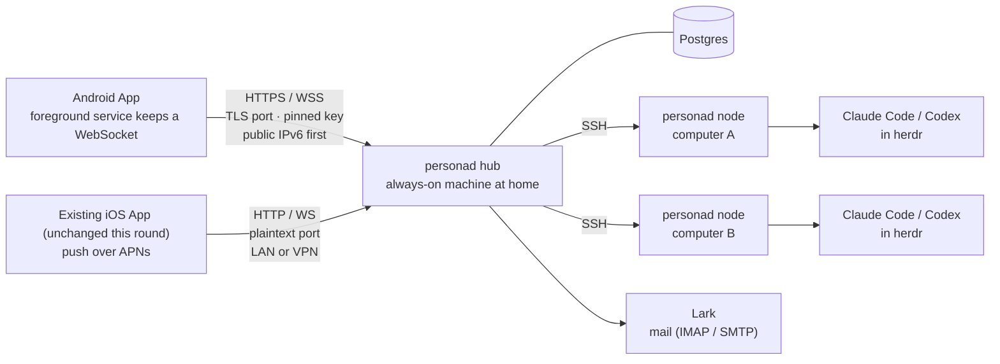

## 2. Pairing

The QR code format is unchanged (the existing iOS can still scan it); the token becomes a temporary one, valid for 10 minutes and usable once. New parameters are for Android.

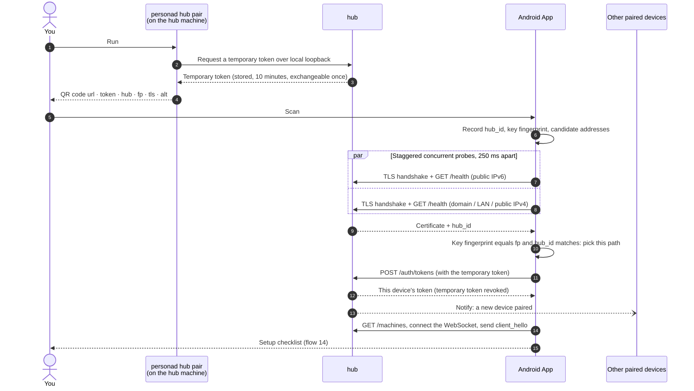

## 3. How pairing failures are reported

No fake progress; failures give actionable hints by cause. A timeout on home Wi-Fi first rules out the local network permission (from Android 17, a missing grant shows up as a timeout).

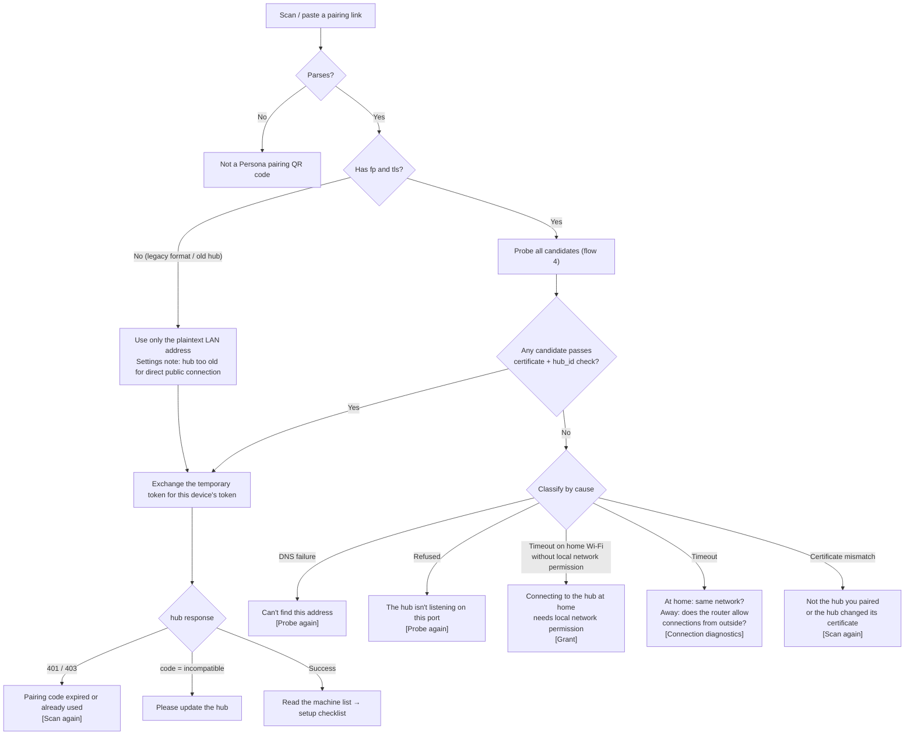

## 4. Route selection: probing multiple addresses

Modeled on Happy Eyeballs v2 (RFC 8305): staggered concurrent attempts; the first to pass the identity check wins. An old prefix may have been handed to someone else, so "reachable" is not enough: both the certificate and `hub_id` must match.

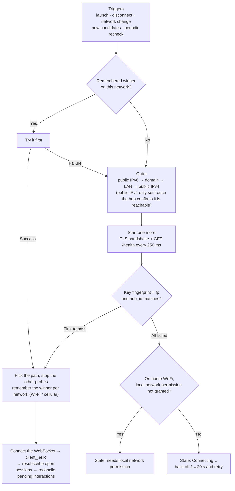

## 5. Connection state

The four iOS states are copied as is; Android adds three states that need you (orange, no automatic retry: after granting it returns to "Connecting", after rescanning it pairs from scratch). Getting worse must last 1.5 seconds before it shows; recovery shows immediately.

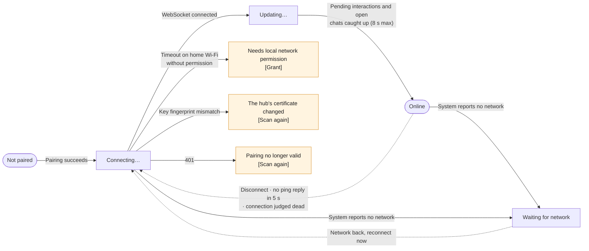

## 6. Persistent connection and heartbeat

When Android is in deep sleep, client pings do not fire (OkHttp's timers use `System.nanoTime`, which stops during deep sleep), so background heartbeats are sent by the hub, at an interval negotiated per connection. Old connections (the existing iOS) do not negotiate and stay at 20 seconds.

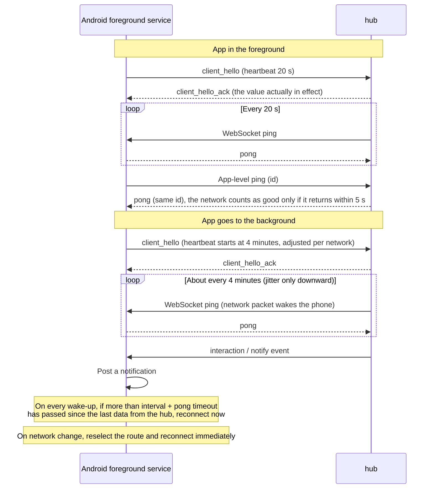

## 7. Finding the hub again after its address changes

When home broadband redials, the IPv6 prefix changes and old connections drop on the spot. Android has no side channel like FCM, so when you are away the only way back is the domain name, which is why DDNS is recommended.

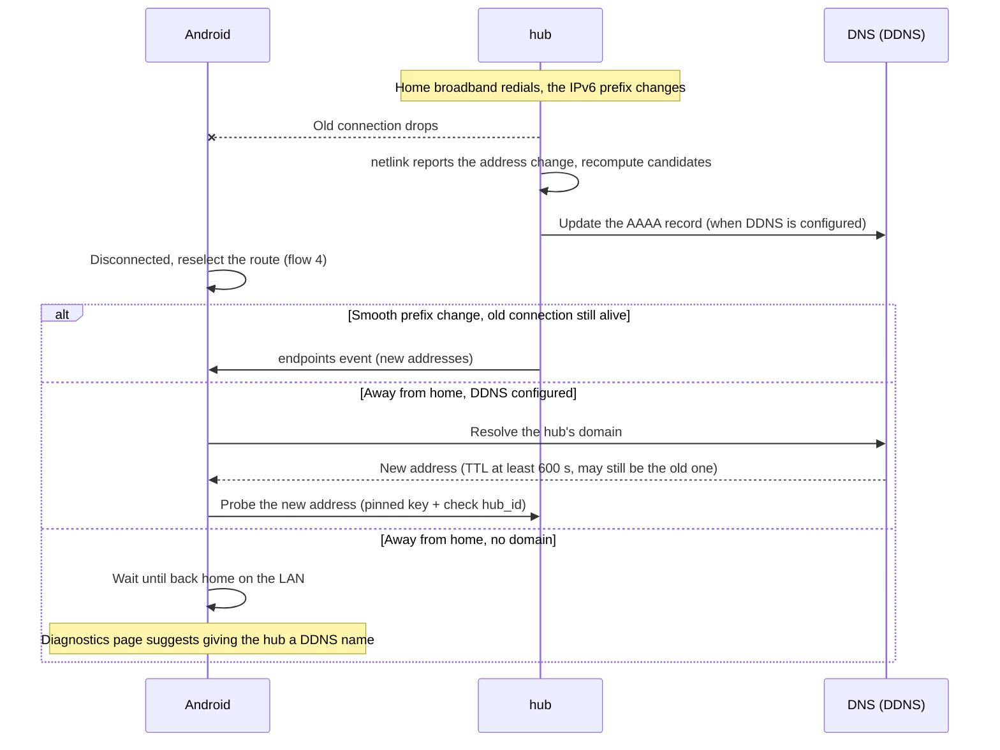

## 8. Notification → approval → Agent continues

"Allow / Approve" requires unlocking first; a deny reason or plan feedback can be typed right in the notification. Once handled (wherever it was handled), the notification is withdrawn.

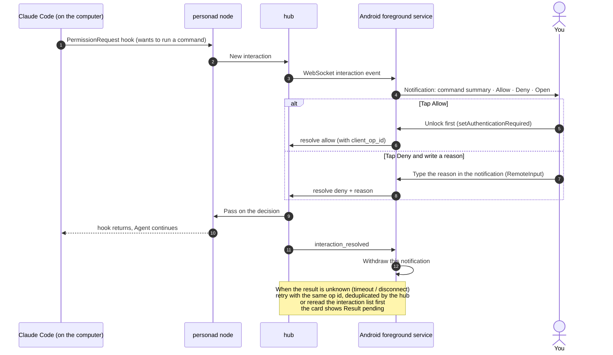

## 9. "Done" notification

The hub decides whether to send it; iPhone and Android use the same rules, only the delivery channel differs. The phone only displays it and no longer computes it itself (with PR #84 the phone currently computes it itself).

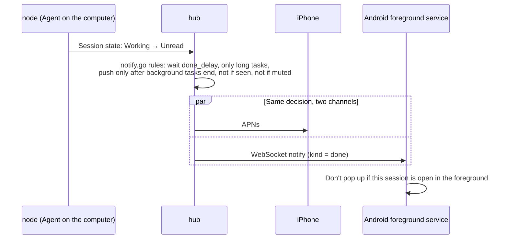

## 10. Sending a message: outbox and three result states

Write to the outbox first, then clear the input box; the same message always uses the same `client_msg_id`. "Sent but no reply" is no longer treated as offline and blindly resent.

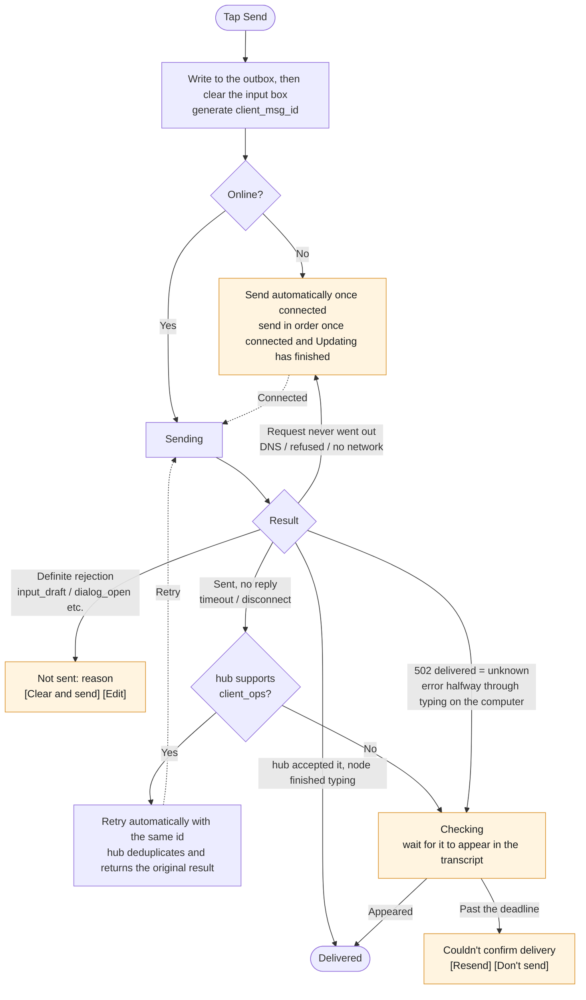

## 11. Opening a chat: sync and continuity

The rules follow `docs/protocol/protocol.md` ("Continuity of items" and "Collapsed work") and are written into `spec/fixtures/continuity/`, shared by the Android reducer and the Go simulation.

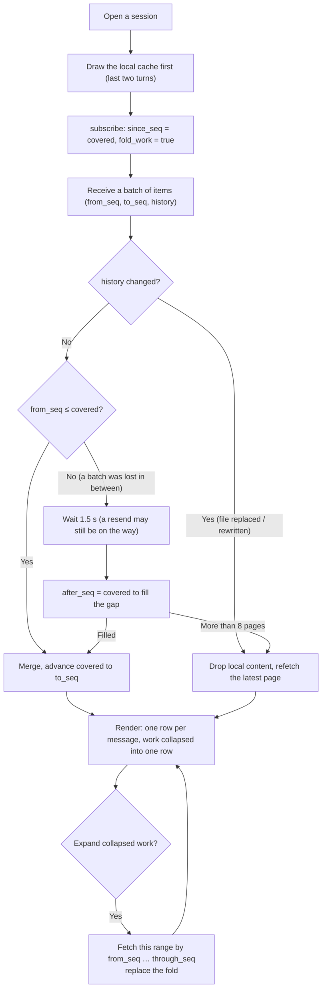

## 12. Inbox and AI twin

Lark messages and mail share one list, one row per item. The AI twin only drafts and never sends; sending takes a tap from you. Sends carry a clientId, so a retry never sends twice.

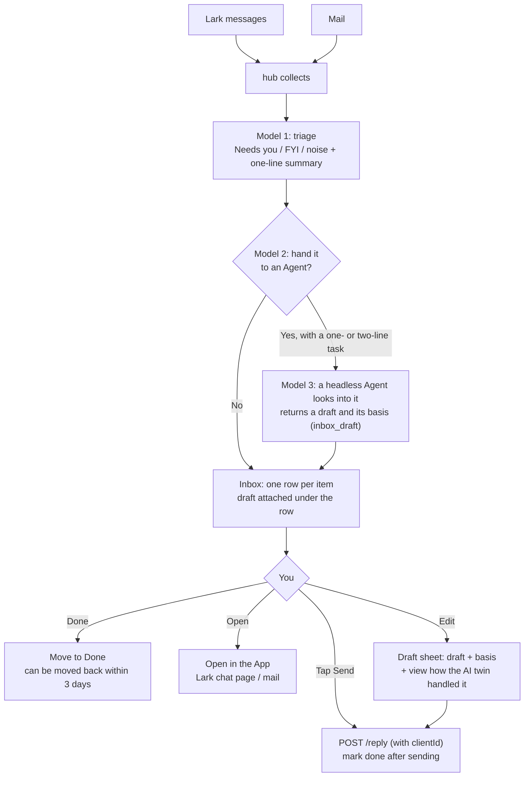

## 13. Share to Persona

An Android-only entry point: text, links, images and files from any App go into Persona, which fits "collect information from everywhere and hand it to AI" exactly.

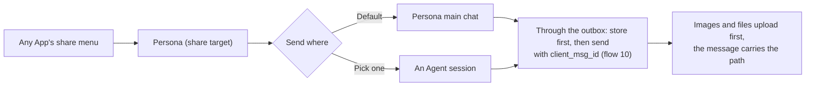

## 14. First-run setup checklist (Chinese Android ROMs)

After pairing, check item by item; every item can be skipped, and says what you lose by skipping it. No Chinese Android ROM offers an API to check auto-start or the background allowlist, so what can be checked shows its real state, what can't gets steps for that ROM, and a lock-screen test notification is the backstop. Each vendor's entry points are in [android.md](android.md) 5.18.

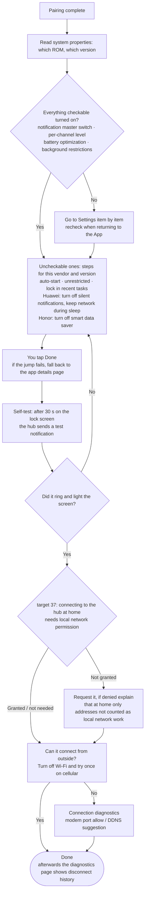

## 15. In-app update

There is no Play Store. The APK lives on the hub, is downloaded over TLS (pinned to the same public key), and the system installer upgrades it. On HyperOS a silent-install request fails outright (`INSTALL_FAILED_ABORTED`, with no dialog at all), so Chinese ROMs always get the system confirmation. The first install has no device token: use the LAN download link printed by `personad hub pair --android`, or adb.

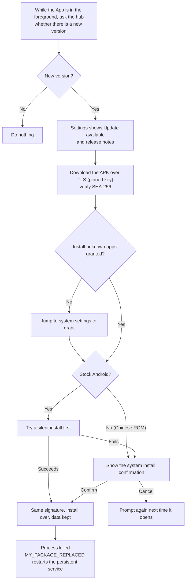
